# Blender Humanoid

A humanoid figure generated entirely from Python in Blender 4.2.1 LTS. There is
no hand-modelled mesh and no `.blend` file to keep in sync: one script builds the
body, head, hair, eyes, clothes and studio lighting, then renders a full-body
plate and two head close-ups.

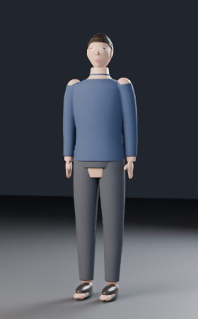

## Gallery

Ten iterations, one render each:

<table>
<tr>
<td align="center">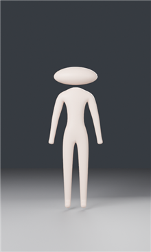<br><b>v1</b><br>proportions</td>
<td align="center">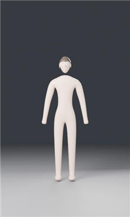<br><b>v2</b><br>face shaping</td>
<td align="center">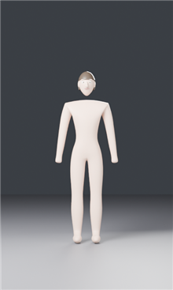<br><b>v3</b><br>materials</td>
</tr>
<tr>
<td align="center">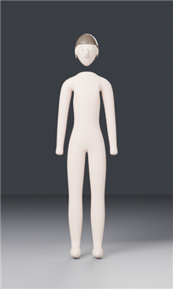<br><b>v4</b><br>hair and light</td>
<td align="center">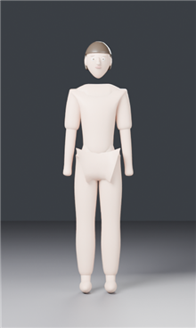<br><b>v5</b><br>hands and shoes</td>
<td align="center">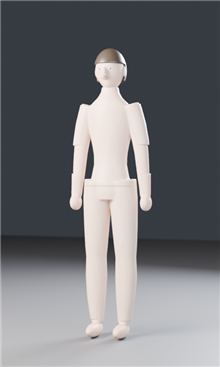<br><b>v6</b><br>garment solids</td>
</tr>
<tr>
<td align="center">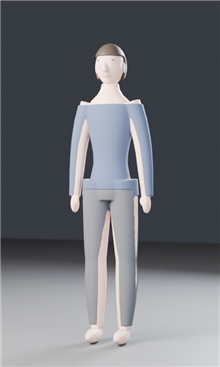<br><b>v7</b><br>folds and weave</td>
<td align="center">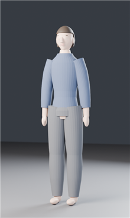<br><b>v8</b><br>head close-up</td>
<td align="center">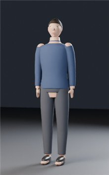<br><b>v9</b><br>current</td>
</tr>
</table>

v9 head plates, in the three render modes:

<table>
<tr>
<td align="center">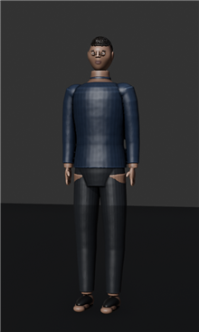<br>form (Workbench)</td>
<td align="center">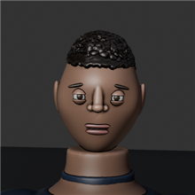<br>head, form</td>
<td align="center">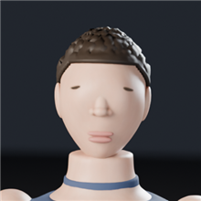<br>head, EEVEE</td>
<td align="center">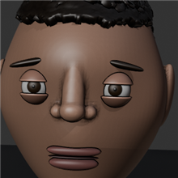<br>eye close-up</td>
</tr>
</table>

The full-size originals are in `renders/`. `probe_*.png` and `test_render.png`
are engine-timing probes, not figure renders.

## Requirements

- Blender 4.2.1 LTS (the script uses `bpy.ops.object.voxel_remesh`,
  `BLENDER_EEVEE_NEXT` and AgX view transforms).
- Any OS. Renders are written by path, not by platform.
- No GPU required. The final pass renders on the CPU with Cycles.

## Run it

```bash
blender --background --factory-startup --python humanoid.py
```

The script starts from an empty factory scene, builds the figure and writes into
`renders/` next to the script:

- `humanoid_v9.png` — full body, 560x900, Cycles CPU, 24 samples, denoised
- `humanoid_v9_head.png` — head close-up, 85 mm lens at f/2.8
- `humanoid_v9_head_eye.png` — eye close-up, 360x360

### Environment variables

| Variable | Values | Default | What it does |
| --- | --- | --- | --- |
| `HUM_MODE` | `final`, `light`, `form` | `final` | `final` = Cycles CPU; `light` = EEVEE Next; `form` = Workbench studio shading for fast shape checks |
| `HUM_OUT` | any directory | `./renders` | Where PNGs are written |

Previews add a suffix to the filename: `HUM_MODE=form` writes
`humanoid_v9_form.png` and `humanoid_v9_head_form.png`.

A fast shape check, without waiting for Cycles:

```bash
HUM_MODE=form blender --background --factory-startup --python humanoid.py
```

On PowerShell:

```powershell
$env:HUM_MODE="form"
blender --background --factory-startup --python humanoid.py
```

## How the figure is built

`humanoid.py` runs top to bottom, in this order:

1. **Body.** The torso is a lofted solid through seventeen measured cross
   sections for a 1.79 m figure. Arms and legs are swept tubes with separate
   radius profiles; hands get a palm, four fingers and a thumb; feet get heel,
   arch, forefoot and toes. Everything is joined and voxel-remeshed at 5.5 mm so
   the parts fuse into one continuous surface, then smoothed.
2. **Head.** A UV sphere is scaled to skull dimensions, then displaced by a set
   of Gaussian feature strokes (brow, cheekbones, chin, temples, muzzle, eye
   sockets) so it reads as a face rather than a ball. Nose bridge, tip, alae and
   ears are added, and the whole skull is fused with a 2.2 mm voxel remesh.
3. **Hair.** A shell is grown off the skull, cut to a hairline curve with a
   widow's peak and tapered temples, solidified, then seeded with about 1,900
   short coils that follow the normal and comb backward. Lock placement is
   deterministic (`random.Random(5)`).
4. **Eyes.** Eyeball, iris and pupil, plus upper and lower lids built as
   spherical caps that hug the eyeball, so the sockets read as real openings.
5. **Garments.** Shirt with collar and sleeves, trousers and shoes, each built as
   its own solid with a cloth or leather material and a procedural fold
   displacement.
6. **Materials.** Subsurface skin with a noise-driven colour ramp and bump,
   anisotropic hair, woven cloth bump, leather and floor.
7. **Studio.** Three area lights (key, fill, rim) on track-to constraints, a dark
   world, an 85 mm camera with depth of field, AgX at medium-high contrast.
8. **Render.** Three stills: full body, head, eye.

## Files

| File | Purpose |
| --- | --- |
| `humanoid.py` | Builds and renders the figure (v9) |
| `probe.py` | Reports CPU, RAM, GPU and render-engine timings for this machine |
| `test_render.py` | Minimal subdivided-sphere render used to measure baseline render time |
| `renders/` | Output PNGs, kept as the visual history of the model |

## Known limits

- Single frame, no rig, no armature, no animation, no UV unwrap.
- The figure is a sculpture: the topology is built for a still, not deformation.
- Cycles runs on the CPU, so `HUM_MODE=form` or `light` is the practical way to
  iterate on shape and lighting.
- Geometry is deterministic, but denoising and sampling can leave small
  differences between runs.
